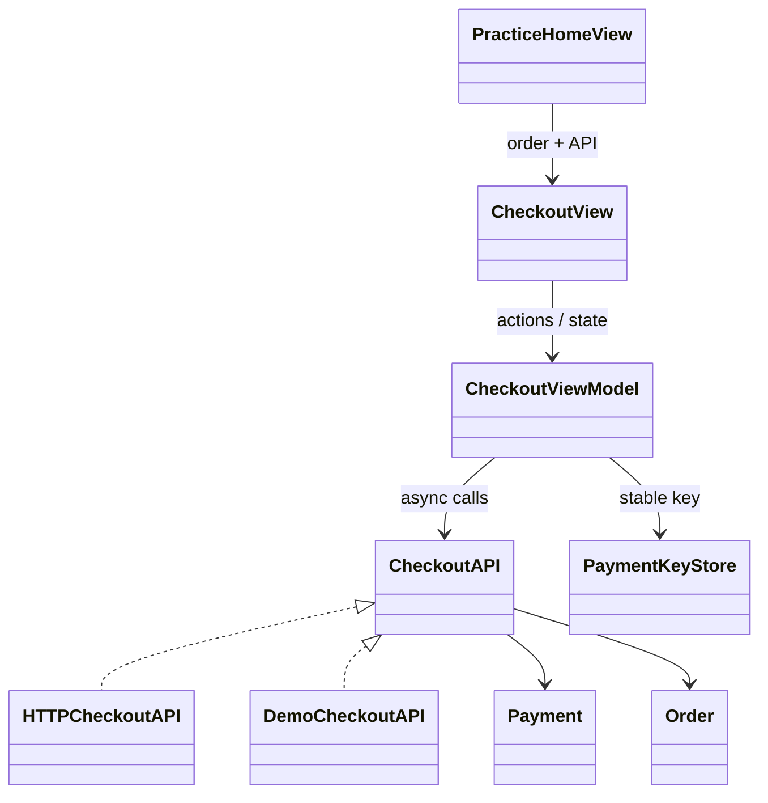
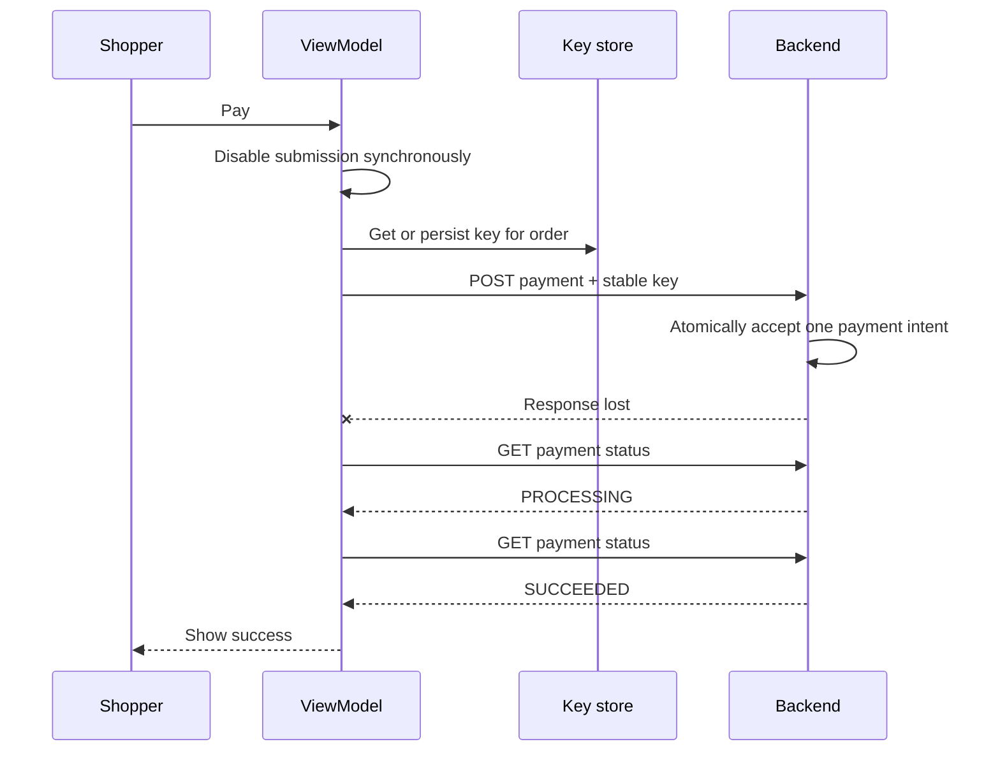

# LLD notes: reliable checkout

## Problem statement

A shopper pays an existing order. Repeated taps, request retries, app restarts, and lost responses must not accidentally create another payment. The UI must distinguish a confirmed failure from an unknown outcome.

**Invariant:** show success only when backend order/payment data says it succeeded. A timeout is not a decline. Cancellation of observation is not cancellation of payment.

## Requirements and boundaries

Functional: create an order, submit payment, reuse a durable key, query status, show a result, and restore the active order on relaunch.

Quality goals: deterministic UI transitions, bounded network work, testable dependencies, explicit unknown state, and server-owned money/status.

Scope: one account-less order at a time, INR, no real gateway or card entry. Order creation has no idempotency contract in the supplied API; a lost create-order response can leave an orphan order. Payment deduplication does not solve that separate problem.

## Responsibilities

| Type | Responsibility | Reason to change |
| --- | --- | --- |
| Order / Payment | Codable backend data | Wire contract changes |
| CheckoutAPI | Async capability boundary | Supported operations change |
| HTTPCheckoutAPI | URL, headers, transport, decode | HTTP contract changes |
| PaymentKeyStore | Get or create a durable order key | Persistence policy changes |
| CheckoutViewModel | Presentation state, submission guard, polling | Checkout interaction changes |
| CheckoutView | Render state and forward actions | Layout changes |
| PracticeHomeView | Choose dependencies and restore active order | App composition changes |
| DemoCheckoutAPI | Simulate acceptance and durable payment identity | Exercise scenarios change |

This is MVVM with dependency injection. The API protocol is a useful variation point: the ViewModel can use HTTP, a durable demo actor, or a deterministic test stub. Avoid adding factories and repositories until a real responsibility requires them.

## Presentation state machine

| Current state | Event | Next state |
| --- | --- | --- |
| ready | Pay, with no task in flight | submitting |
| submitting | Valid PROCESSING payment | processing |
| submitting | Timeout, 5xx, ambiguous error | processing, then status lookup |
| submitting | Contract-defined 400/401/403/422 | rejected |
| submitting / processing | Valid SUCCEEDED payment | succeeded |
| submitting / processing | Valid FAILED payment | failed |
| processing | 404 before any known acceptance | ready; same-key retry allowed |
| processing | 404 after observed acceptance | Continue lookup, eventually unknown |
| processing | Poll budget exhausted or observation cancelled | unknown |
| unknown / rejected / ready | Check status or screen resume | processing |
| any observation | Payment identity / amount / currency mismatch | unknown |

The initial state comes from Order.status. `PAYMENT_PENDING` immediately makes acceptance known. Succeeded and failed are terminal for this exercise.

## Concurrency and lifecycle

`@MainActor` serializes ViewModel and key-store access. The state changes before the Task begins, so a second tap cannot enter submission. Main-actor isolation does not prevent task interleaving across an `await`; the in-flight task guard is still required.

The API is Sendable. The demo server is an actor, serializing its in-process records. Neither actor isolation nor the local task guard protects a real distributed server; database constraints and gateway deduplication must do that.

The view cancels observation when it disappears. Cooperative cancellation eventually sets unknown and clears the task with `defer`. The backend may still finish. Reopening restores the saved order and queries payment status, even if the cached order says CREATED.

## Choices and tradeoffs

- Enum state avoids contradictory Boolean combinations such as loading + success + error.
- Minor-unit Int64 avoids floating-point calculations for money. Double is used only for this fixed-currency display.
- Keys are persisted before POST. Regenerating a key after timeout defeats deduplication.
- Polling is limited to ten lookups, with two-second gaps; network timeouts add to wall-clock duration. No delay follows the last lookup.
- A 404 permits ready only before this ViewModel has observed acceptance. A consistent backend lookup and atomic key handling are still required.
- Response matching catches accidental cross-order data, but server authorization and request validation remain necessary.
- Error classification follows an explicit demo contract. Do not assume every backend treats the same HTTP status identically.

## What changed from the supplied snippet

The single file is split into responsibilities, with an app entry point, order creation UI, persisted active order, durable scenario simulator, and tests. The ViewModel now reconciles ambiguous 4xx outcomes, avoids enabling Pay after a known payment temporarily disappears, validates returned payment identity, and accepts polling settings for fast tests.
